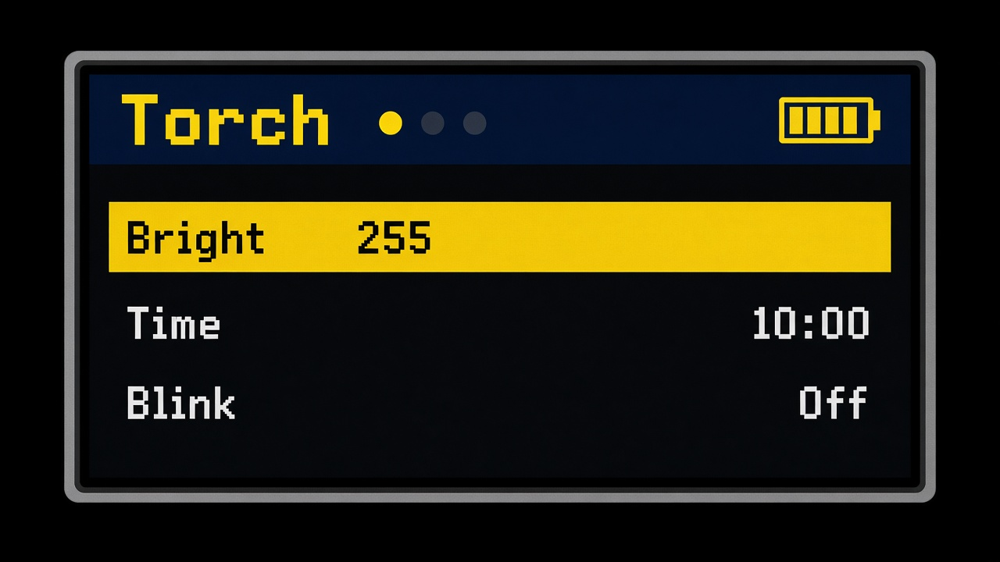
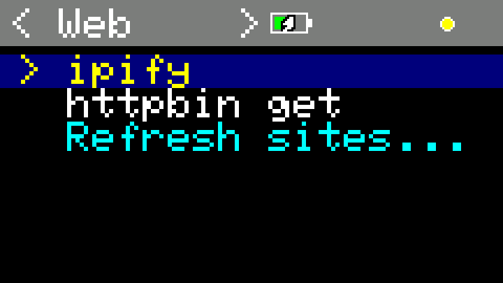
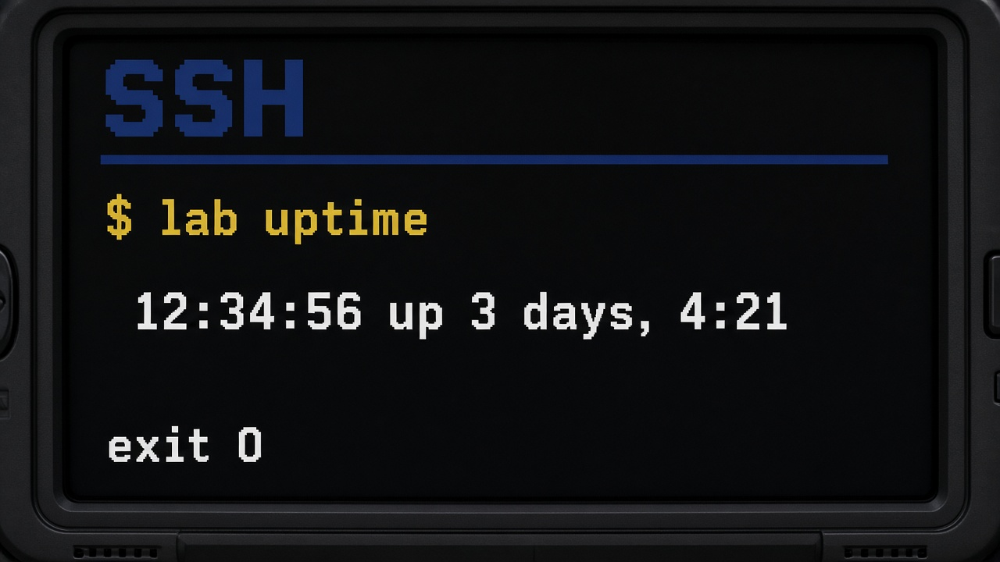
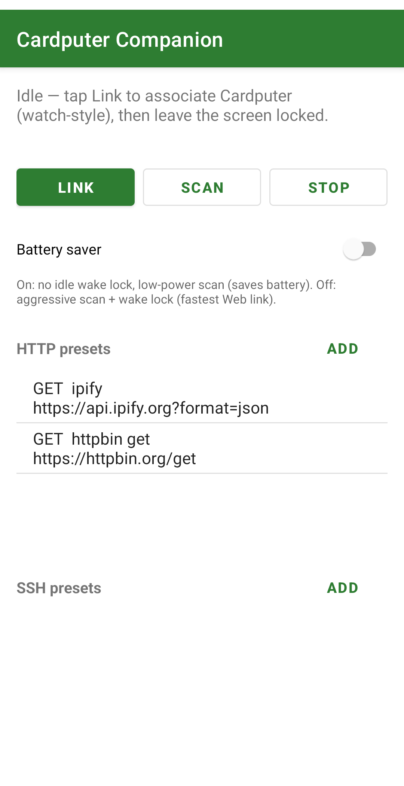
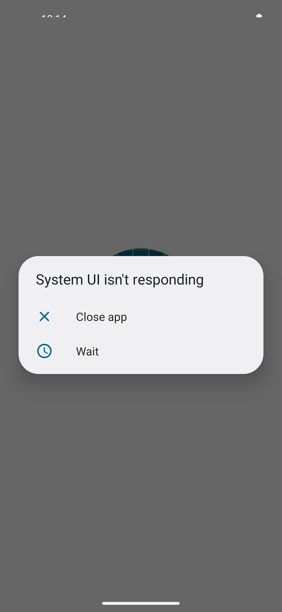
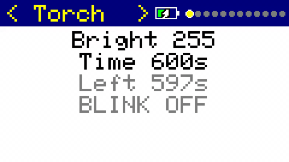

# cardputer_adv_firmware

[](https://www.apache.org/licenses/LICENSE-2.0)
[](https://docs.espressif.com/en/latest/esp32s3/index.html)
[](https://github.com/bluedskim/cardputer_adv_firmware/releases/latest)

**Multi-app firmware for the M5Stack Cardputer-Adv** — stock-style app switching, on-device utilities, and BLE-backed **Web**, **SSH**, and **Find** through the Android companion.

**Hardware:** [M5Stack Cardputer-Adv](https://docs.m5stack.com/en/core/Cardputer-Adv) (ESP32-S3, TCA8418 keyboard)

**Current release:** **[v0.8.9](https://github.com/bluedskim/cardputer_adv_firmware/releases/tag/v0.8.9)** · Companion `0.8.9` (M5 Find) · Assets: [`cardputer_adv_firmware-0.8.9.bin`](https://github.com/bluedskim/cardputer_adv_firmware/releases/tag/v0.8.9) · [`CardputerCompanion-0.8.9.apk`](https://github.com/bluedskim/cardputer_adv_firmware/releases/tag/v0.8.9)

<!-- Add demo.gif here (10s app switch / Find phone) -->

<p align="center">
  
  
  
</p>

## Quick start

| Goal | What to do |
| ---- | ---------- |
| **Flash firmware** | Download **`cardputer_adv_firmware-0.8.9.bin`** from [Releases](https://github.com/bluedskim/cardputer_adv_firmware/releases/tag/v0.8.9) and flash over USB (see [Build](#build) for `pio run … -t upload` and Fedora USB permissions). |
| **Android companion** | Sideload **`CardputerCompanion-0.8.9.apk`** from the same release; setup in [companion/](companion/) and [docs/m1_verify.md](docs/m1_verify.md). |
| **Build from source** | [Development environment (Fedora)](#development-environment-fedora) → PlatformIO → `pio run -e m5stack-cardputer -t upload` ([Build](#build)). |
| **Try without hardware** | Desktop simulator: `pio run -e sim -t upload` ([Desktop simulator](#desktop-simulator)). |

Custom firmware for the M5Stack **Cardputer-Adv**. Switch apps left/right like the stock UI. Includes **Torch**, **Timer**, **Stopwatch**, **Recorder** (microSD WAV), **Level** (two-axis spirit level), **Seismo** (vibration trace), **Tuner** (six guitar reference tones), **Metro** (clip-on style metronome), **Web** (HTTP presets — not a browser), **SSH** (one-shot exec — not an interactive shell), **Find** (phone vibrate / optional sound), and **Settings**.

Primary development target is **Fedora**; setup and flash steps below prefer Fedora, with notes for other platforms.

## Screenshots

### Cardputer firmware


| Torch                           | Web list            | SSH result                  |
| ------------------------------- | ------------------- | --------------------------- |
| Brightness / timeout flashlight | Pick an HTTP preset | Exit status + stdout paging |


### Android Companion

    


| Main                                 | SSH preset                            |
| ------------------------------------ | ------------------------------------- |
| Link / Scan / Stop, HTTP & SSH lists | Edit host + **Test run** before flash |


## Development environment (Fedora)

### 1. System packages

```bash
sudo dnf install git python3-pip gcc-c++ make SDL2-devel pkg-config
```


| Package                    | Purpose                   |
| -------------------------- | ------------------------- |
| `git`, `python3-pip`       | PlatformIO, cloning       |
| `gcc-c++`, `make`          | Native / sim builds       |
| `SDL2-devel`, `pkg-config` | Desktop simulator (`sim`) |


### 2. PlatformIO

**Cursor / VS Code extension** (recommended): install [PlatformIO IDE](https://platformio.org/install/ide?install=vscode), open the repo, and let it fetch dependencies from `platformio.ini`.

**CLI only:**

```bash
pip install --user platformio
# Add ~/.local/bin to PATH if needed (e.g. ~/.bashrc)
export PATH="$HOME/.local/bin:$PATH"
pio --version
```

On the first build from the repo root, the ESP32 toolchain and libraries download under `~/.platformio`.

### 3. USB upload and serial monitor

Cardputer-Adv (ESP32-S3) appears as USB CDC on `/dev/ttyACM*`. Without permission, `pio run -t upload` or `pio device monitor` fails.

**Option A —** `dialout` **group (typical)**

```bash
sudo usermod -aG dialout "$USER"
# Log out and back in (or reboot)
```

**Option B — udev rule (Espressif)**

`/etc/udev/rules.d/99-espressif.rules`:

```
SUBSYSTEM=="usb", ATTR{idVendor}=="303a", MODE="0666", GROUP="dialout"
```

Apply:

```bash
sudo udevadm control --reload-rules
sudo udevadm trigger
# Replug the USB cable
```

Check the port:

```bash
pio device list
```

### 4. Other Linux / macOS / Windows


| OS            | Notes                                                                                                                                      |
| ------------- | ------------------------------------------------------------------------------------------------------------------------------------------ |
| Debian/Ubuntu | `sudo apt install build-essential git python3-pip libsdl2-dev pkg-config` · serial group `dialout`                                         |
| macOS         | [PlatformIO IDE](https://platformio.org/install/ide?install=vscode) · sim: `brew install sdl2 pkg-config` ([sim/README.md](sim/README.md)) |
| Windows       | PlatformIO IDE · sim: MSYS2 + SDL2 ([sim/README.md](sim/README.md))                                                                        |


## UI

Shared **two-level arrow navigation**. Prefer arrows, Enter, and Del over letter shortcuts.

- Top header bar: app name, page dots, battery
- **G0** short press (any app) → open **Recorder** and start recording. If already recording → stop & save

### Arrow keys

Use the arrow glyphs printed on the keycaps. **Fn + arrow** works the same way.


| Key           | Direction |
| ------------- | --------- |
| `;` or Fn+`;` | Up        |
| `,` or Fn+`,` | Left      |
| `.` or Fn+`.` | Down      |
| `/` or Fn+`/` | Right     |


### Common controls


| Action                    | Keys                                                     |
| ------------------------- | -------------------------------------------------------- |
| Move selection            | `↑` `↓`                                                  |
| Adjust value / no submenu | `←` `→` (app-dependent)                                  |
| Select / run              | `Enter`                                                  |
| Back                      | `←` or `Del`                                             |
| Switch apps               | From the **top** of a list, `↑` → header focus → `←` `→` |
| Return to app             | From the header, `↓` or `Enter`                          |


When header is focused, the bar turns navy and the title yellow.

## Features

### Torch

Full-brightness backlight as a flashlight.


| Action                                     | Keys                      |
| ------------------------------------------ | ------------------------- |
| Focus Bright / Time / Blink                | `↑` `↓`                   |
| Adjust brightness or timeout; toggle Blink | `←` `→`                   |
| Toggle Blink (when focused)                | `Enter`                   |
| Switch apps                                | From Bright, `↑` → header |


- Timeout step: **60 s** (max **60 min**)
- Default timeout: **10 min (600 s)**
- When the timeout expires, the light turns off and can turn on again (any key restarts the timer)
- Long high-brightness use stresses the panel — keep a timeout set

### Timer

Multiple countdown timers stored in NVS. Set **hours and minutes** only.

**List**

- `↑` `↓` — timer / `+ New`
- `Enter` — open / start / clear done / add New
- While running, `Enter` — cancel
- Top row `↑` — header (app switch)

**Edit**

- `↑` `↓` — Hours / Minutes / `> Start` / `x Remove`
- `←` `→` — adjust hours/minutes (0–23 h, 0–59 m)
- `Enter` — Start or Remove (confirm)
- `←` / `Del` — back to list

Finished timers show `DONE` in the list.

### Stopwatch

Named timing sessions stored in NVS (max **10**).


| Item         | `Enter`                            |
| ------------ | ---------------------------------- |
| Name         | Edit name                          |
| Start / Stop | Start or stop (Stop saves history) |
| History      | Saved runs                         |


- `↑` `↓` — move · top `↑` → header
- History: `↑` `↓` scroll · `←` / `Del` back

### Recorder (voice)

On-device mic → **microSD** WAV (32 kHz mono PCM). Requires a formatted microSD card.

**List**

- `↑` `↓` — file / `+ New recording`
- `Enter` — play file, or start a new recording
- **G0** short (from any app) — jump here and start recording; while recording, stop & save
- `Del` — delete selected file (confirm)
- Top row `↑` — header (app switch)
- No card: `No SD — Enter` retries mount

**Record**

- Shows elapsed time, filename (`REC_XXXX.wav`), and a level bar
- **G0** short or `Enter` — stop and save · `Del` — cancel and discard
- Max length **10 min**. The record screen does not return to the header, so another app cannot be opened mid-take

**Play**

- `Del` — delete this file (confirm) · `Enter` — no action
- `←` — stop and return to list · playback end → list

Files live under `/rec/` on the SD card.

### Level (split level)

Two-axis spirit level from the Cardputer-Adv accelerometer. Screen faces up.

- **Roll** — left / right tilt, horizontal bar. **Pitch** — near / far tilt, vertical bar on the right. Signed degrees, center-zero, ±30° full scale
- Both axes within **±1°** → footer `LEVEL`
- No accelerometer → footer `No IMU`
- `↑` → header (app switch)

### Seismograph

Vibration trace from the accelerometer. The header name is **Seismo** (the full word does not fit).

- One left-to-right sweep, about 12 s. The center line is still. A yellow line marks the write head
- Footer `+-100mg peak 12` — full scale, and the peak of this sweep
- `←` `→` — scale 20 / 50 / 100 / 200 mg. Default ±100 mg
- No accelerometer → footer `No IMU`
- `↑` → header (app switch)

### Tuner

Reference tones for Standard guitar open strings (EADGBE, A4=440). Plays a synth sine on the speaker — not a mic pitch detector.

- Large string letter (`E` / `A` / `D` / `G` / `B` / `e`) and frequency in Hz
- `←` `→` — select string · `Enter` — play / stop (sustained tone)
- Last string is saved in NVS
- `↑` → header (app switch)

### Metro (metronome)

Yamaha ME-110–style clip-on metronome. The header name is **Metro**.

- Beat LEDs match the Beat setting (accent = red, others = yellow), large BPM, click on the speaker
- **Tempo** 30–250 · **Beat** 0–7 (0 = no accent) · **Vol** 0–10 — saved in NVS
- `↑` `↓` — focus Tempo / Beat / Vol · `←` `→` — adjust · `Enter` — start / stop
- From Tempo, `↑` → header (app switch)

### Web (HTTP commander)

Phone-backed **HTTP presets** over BLE — pick a saved request and view the response body. **Not a web browser** (no arbitrary URL entry or page rendering on the device).

Cache-first name list; trailing **Refresh sites...** forces a sync. Enter runs a preset; result shows status + body paging. Companion also notifies when the run finishes (success includes the body, up to 512 bytes).

See [docs/m2_verify.md](docs/m2_verify.md) · [docs/ble_link.md](docs/ble_link.md).

### SSH (exec-only)

Phone-backed **one-shot SSH exec** over BLE — pick a saved host/command and view stdout/stderr. **Not an interactive SSH client** (no PTY, no typing commands on the Cardputer).

Cache-first list; **Refresh hosts...**; result shows exit status + stdout/stderr paging. Companion also notifies when the run finishes (success includes the body, up to 512 bytes).

See [docs/m3_verify.md](docs/m3_verify.md) · [docs/ble_link.md](docs/ble_link.md).

### Find (phone)

On-demand **Find My Phone**. Vibration is always on. **Sound Off/On** is chosen here (saved in NVS) and sent with each start.

- `↑` `↓` — Sound / Find phone · from Sound, `↑` → header
- `←` `→` or `Enter` on Sound — toggle Off/On
- `Enter` on Find phone — start or stop
- `Del` while finding — stop
- Phone shows a Stop notification; auto-stop after 60 s. The device keeps the BLE link up for that session (the usual 60 s idle disconnect does not cut it short)

See [docs/m5_verify.md](docs/m5_verify.md).

### Settings

Last app in the order. Sleep, brightness, BLE link, **Apps** (show/hide), battery, and firmware version.

- `↑` `↓` — Sleep / Bright / BLE / Apps · from Sleep, `↑` → header
- `←` `→` — Sleep: **Immediate** / 30 s / 1 min / **5 min** / 10 min / **Never** · Bright: 32 / 64 / **128** / 192 / 255
  - Immediate: screen off soon. **On sleep**, Sleep is rewritten to **30 sec** and saved (pick Immediate again to reuse)
- **BLE row:** status summary (`Off Unpaired` / `Off Paired` / `Pairing` / `Connecting` / `Connected` · sim: `N/A`). `Enter` → BLE submenu
- **BLE submenu**
  - Shows status and peer (when known)
  - Contextual actions only: unpaired `Pair` · paired `Connect` / `Forget` · in progress `Cancel` · connected `Disconnect`
  - Forget asks `Forget?` (`Enter` yes / `Del` cancel)
  - `←` / `Del` / top `↑` → main Settings (BLE row focused)
- **Apps:** `Enter` → list of apps (Settings is not listed and cannot be hidden). `→` or `Enter` toggles **show** / **hide**. `←` / `Del` / top `↑` → main Settings. Hidden apps are skipped by header Left/Right and omitted from page dots. G0 still opens Recorder even if it is hidden. Saved in NVS
- **Battery:** percent and voltage on one line (charging shown on the header battery icon)
- **S/W Ver:** firmware version (`kFirmwareVersion` in `config.h`)
- With no input, backlight turns off after Sleep. GPIO light sleep (wake only on **TCA8418 INT, GPIO11**) runs when no app has background work (timer, stopwatch, recording, playback, Find, or an in-flight Web/SSH request) **and** the NimBLE stack is down. After the first pair or connect the stack stays resident — `NimBLEDevice::deinit()` reboots this board — so light sleep stays off until reboot even when the radio is `Off Paired`. Pairing, connecting, or a live link also skips light sleep. An open link with no frames for **60 s** disconnects and powers the radio down; an active Find session holds that timer until the alert ends.
- Torch uses its own brightness; leaving Torch restores Settings Bright
- Android companion: `[companion/](companion/)` · protocol: `[docs/ble_link.md](docs/ble_link.md)` · verify: `[docs/m1_verify.md](docs/m1_verify.md)`

## Desktop simulator

Preview Torch / Timer / Stopwatch / Recorder / Level / Seismo / Tuner / Metro / Web / SSH / Find / Settings on a PC with `sim/`. Recorder has no real mic/SD (shows unavailable). Level has no accelerometer (stays at 0°). Seismo stays at 0 mg. Tuner / Metro have no real speaker tone. Find cannot reach a phone.

<p align="center"><br/><sub>App switching in the desktop simulator</sub></p>

On Fedora, install the **system packages** above (`SDL2-devel`, `pkg-config`, …), then:

```bash
pio run -e sim -t upload
```

The `upload` target opens an SDL window. Keys, layout, and limits: [sim/README.md](sim/README.md).

## Build

Flash over USB. On Fedora, fix [USB permissions](#3-usb-upload-and-serial-monitor) first:

```bash
pio run -e m5stack-cardputer
pio run -e m5stack-cardputer -t upload
pio device monitor
```

The build copies `dist/cardputer_adv_firmware.bin`. GitHub Release assets are versioned, e.g. **`cardputer_adv_firmware-0.8.9.bin`** and **`CardputerCompanion-0.8.9.apk`** (sideload; debug-signed until a store keystore is added).

If upload fails: use a **data** cable, confirm the port in `pio device list`, re-login after adding `dialout`, and try bootloader mode (**RST**, etc.) on ESP32-S3.

### Device test checklist

After flashing (sim has no backlight hardware):

- [ ] **Brightness:** In Torch, focus Bright — `←` dims, `→` brightens; at max, `→` stays at 255
- [ ] **Timeout:** Focus Time — `←` `→` step by 60 s; countdown decreases each second; after expiry a message appears and keys work again
- [ ] **Timer:** Add with `+ New`, set Hours/Minutes only, Start → countdown / DONE
- [ ] **Stopwatch:** Rename, Start/Stop, History (max 10)
- [ ] **Settings:** Change/save Sleep & Bright; BLE summary + submenu (Pair/Connect/Cancel/Disconnect/Forget); battery %/V; firmware version; idle backlight off and key wake (same app); GPIO light sleep only before the BLE stack has been started
- [ ] **BLE M1:** BLE → Pair → companion Scan → Connected → Disconnect → `Off Paired` · sleep/wake keeps app · Forget confirm. See [companion/README.md](companion/README.md) · [docs/m1_verify.md](docs/m1_verify.md)
- [ ] **Web M2 / SSH M3:** Linked Companion → open Web or SSH → list / Refresh / run. [docs/m2_verify.md](docs/m2_verify.md) · [docs/m3_verify.md](docs/m3_verify.md)
- [ ] **G0:** Short from any app → Recorder + auto-record; short while recording → stop&save
- [ ] **Recorder:** microSD present → New / G0 start → G0 or Enter stop&save → play → Del delete. No SD shows error.
- [ ] **Tuner:** `←` `→` pick string → Enter plays reference tone; Enter again stops
- [ ] **Metro:** Enter start → 5 LEDs + click; Tempo/Beat/Vol with `←` `→`; Enter stop
- [ ] **Battery:** header icon visible; lightning when USB is plugged (no CHG pin — USB presence is used as a hint)

### Requirements

- Fedora: packages in [Development environment](#development-environment-fedora) + [PlatformIO](https://platformio.org/)
- **Cardputer-Adv** (ESP32-S3, TCA8418 keyboard)
- USB-C **data** cable

M5Cardputer is declared in `platformio.ini`.

## Project layout

```
.
├── platformio.ini
├── scripts/export_firmware_bin.py
├── dist/                     # firmware.bin (after build)
├── docs/                     # ble_link.md · m1/m2/m3/m5 verify · images/
├── companion/                # Android companion (M1–M3, M5 Find)
├── sim/                      # Desktop simulator (SDL2, Arduino/M5 stubs)
├── include/
│   ├── config.h
│   ├── system_settings.h     # Sleep/Bright (NVS)
│   └── ble/                  # Protocol constants · BleLink API
├── src/
│   ├── main.cpp
│   ├── app_shell.*           # App switcher · sleep/wake
│   ├── system_settings.cpp
│   ├── app_visibility.cpp    # Settings → Apps show/hide mask (NVS)
│   ├── ble/ble_link.cpp      # NimBLE link (sim stub)
│   ├── input/                # Key edge · arrow mapping
│   ├── storage/              # microSD helper (Recorder)
│   ├── ui/                   # Battery icon
│   └── apps/
│       ├── torch/
│       ├── timer/
│       ├── stopwatch/
│       ├── recorder/         # Voice recorder (SD WAV)
│       ├── level/            # Split level (accelerometer)
│       ├── seismo/           # Seismograph (accelerometer)
│       ├── tuner/            # Guitar reference tones (6 open strings)
│       ├── metro/            # Metronome (ME-110–style LEDs)
│       ├── web/              # HTTP commander (M2)
│       ├── ssh/              # SSH commander (M3)
│       ├── find/             # Find My Phone (M5)
│       └── settings/
└── README.md
```

## Configuration

Tune values in `include/config.h`:


| Constant                        | Default | Meaning                                           |
| ------------------------------- | ------- | ------------------------------------------------- |
| `kTorchDefaultTimeoutSec`       | 600     | Torch default timeout (s)                         |
| `kTorchMaxTimeoutSec`           | 3600    | Torch timeout cap (s)                             |
| `kMaxTimers`                    | 8       | Max stored timers                                 |
| `kTimerMaxHours`                | 23      | Timer hours cap                                   |
| `kMaxStopwatchHistory`          | 10      | Max stopwatch history entries                     |
| `kRecorderSampleRate`           | 32000   | Recorder WAV sample rate                          |
| `kRecorderMaxDurationSec`       | 600     | Recorder max length (s)                           |
| `kRecorderMaxFiles`             | 32      | Max listed recordings                             |
| `kDefaultSleepOptionIndex`      | 3       | Default Sleep (5 min; includes Immediate / Never) |
| `kDefaultBrightnessOptionIndex` | 2       | Default Bright (128)                              |
| `kBleIdleDisconnectSec`         | 60      | BLE idle → radio off (s)                          |


## Roadmap

- [ ] Features
  - [x] Sleep
  - [ ] ~~Battery charge threshold~~ (hardware unsupported)
  - [ ] Settings backup
  - [ ] Hangul text output

- [ ] More utility apps
  - [x] Voice recorder
  - [ ] Expression calculator
  - [ ] SD reader/writer
  - [x] Metronome
  - [x] Tuner (six guitar reference tones)
  - [x] Timer
  - [x] Stopwatch
  - [ ] Keyboard HID (Bluetooth, USB)
  - [ ] Clock
  - [ ] Eraser Game
  - [x] Seismograph
  - [x] split level
- [ ] SD card backup / restore

### Next major track — phone-backed companion

Theme: Cardputer is a thin terminal UI; an Android phone owns networking, secrets, and background work.
Cardputer Wi‑Fi is unused. Device↔phone link is **BLE** by default.

Goal: keep offline-util standby life near current light-sleep levels.
Always-on notification mirroring costs more battery; **on-demand commanders** cost less.

#### Shared (prerequisite for all companion features)

- [x] BLE pairing, reconnect, connection UI (Settings)
- [x] Link protocol: frame types, request/response IDs, error codes, payload limits ([docs/ble_link.md](docs/ble_link.md))
- [x] Secrets only in phone secure storage (no SSH keys/tokens in Cardputer NVS)
- [x] Sleep / battery policy
  - [x] **BLE off by default** — paired but radio off for standby life
  - [x] **Commander on-demand** — auto Connect for Web/SSH; disconnect on app exit / idle *(Settings Connect optional)*
  - [ ] **Notifications opt-in** — Settings toggle only; when off, fully disconnect *(M4)*
  - [ ] With notifications ON, keep existing display sleep; buffer quietly and refresh lists after wake (forced bright wake optional) *(M4)*
- [x] Out of scope: iOS companion, Cardputer-native Wi‑Fi/SSH stack, full web browser

#### M1 — Companion app (connectivity)

- [x] Android companion (`[companion/](companion/)` · connect / permissions)
- [x] Pairing · default BLE off / connection status
- [x] Out of scope: notification / commander UI (later milestones)

#### M2 — Web commander (HTTP templates)

- [x] Phone presets: name, URL, method, headers/body slots
- [x] Select on Cardputer → run → page response body
- [x] Short messages for timeout, HTTP errors, disconnect
- [x] On-demand link only (preserve standby life)
- [x] Out of scope: arbitrary URL browsing, JS render, cookie journal UI

Verify: [docs/m2_verify.md](docs/m2_verify.md) · protocol: [docs/ble_link.md](docs/ble_link.md)

#### M3 — SSH commander (exec-only)

- [x] Phone host presets: host, user, password (secure storage; key auth out of scope for v1)
- [x] Non-interactive exec: one-line command → stdout/stderr paging
- [x] known_hosts / first-connect handling on companion (TOFU)
- [x] On-demand link only (preserve standby life)
- [x] Out of scope: interactive PTY, port-forward, SFTP, multi-session tmux

Verify: [docs/m3_verify.md](docs/m3_verify.md) · protocol: [docs/ble_link.md](docs/ble_link.md)

#### M5 — Find My Phone (vibrate-first)

- [x] Cardputer **Find** app: Sound Off/On (default Off) + start/stop
- [x] Companion vibrates and shows Stop; ringtone only when Sound On
- [x] On-demand link; 60 s timeout; stop from device, Del, or notification
- [x] Out of scope: GPS, iOS, camera flash

Verify: [docs/m5_verify.md](docs/m5_verify.md) · protocol: [docs/ble_link.md](docs/ble_link.md)

#### M4 — Notification mirror (opt-in, higher standby cost)

- [ ] Settings notification mirror ON/OFF (default OFF)
- [ ] Notification access + read-only mirror (app / title / summary)
- [ ] Cardputer notification list + detail (scroll, `Del` back)
- [ ] No forced screen wake on receive (buffer; manual check; bright wake optional)
- [ ] Out of scope: notification actions (reply/dismiss), media controls, calls

Priority: **shared → M1 → M2 → M3 → M5**. M4 (notifications) stays separate.
Ship commanders before notifications (M4) to protect standby battery.
Keep calculator / metronome / tuner / HID / clock as offline utilities, separate from this major track.

## Debugging

1. [ ] After wake from sleep, UI seemed to always open Torch — should restore the screen that was active at sleep

## License

Copyright 2026 Dennis Kim ([bluedskim](https://github.com/bluedskim)).

This project is licensed under the **Apache License, Version 2.0**. See [LICENSE](LICENSE) for the full text.
